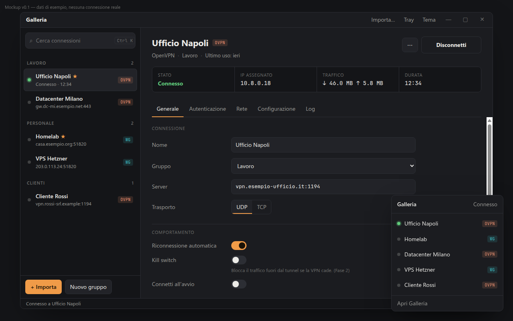

# Galleria

Client desktop open source per OpenVPN e WireGuard (poi le VPN aziendali via OpenConnect e le reti filtrate): una rubrica di connessioni in stile VirtualBox,
una connessione attiva alla volta, Linux e Windows (macOS in seguito).

Stato: analisi + mockup cliccabile, nessun codice dell'app.

## Documenti

- [`docs/00-mercato-e-concorrenti.md`](docs/00-mercato-e-concorrenti.md) — concorrenti, buco reale, validazione
- [`docs/01-analisi.md`](docs/01-analisi.md) — decisioni, funzionalità, architettura, fasi, rischi, punti aperti
- [`design/mockup/Rubrica.html`](design/mockup/Rubrica.html) — mockup cliccabile (aprire nel browser; stati demo con `#on`, `#log`, `#import`, `#tray`, `#light`)

## Licenza

GPL-3.0-or-later. Vedi [`LICENSE`](LICENSE).
