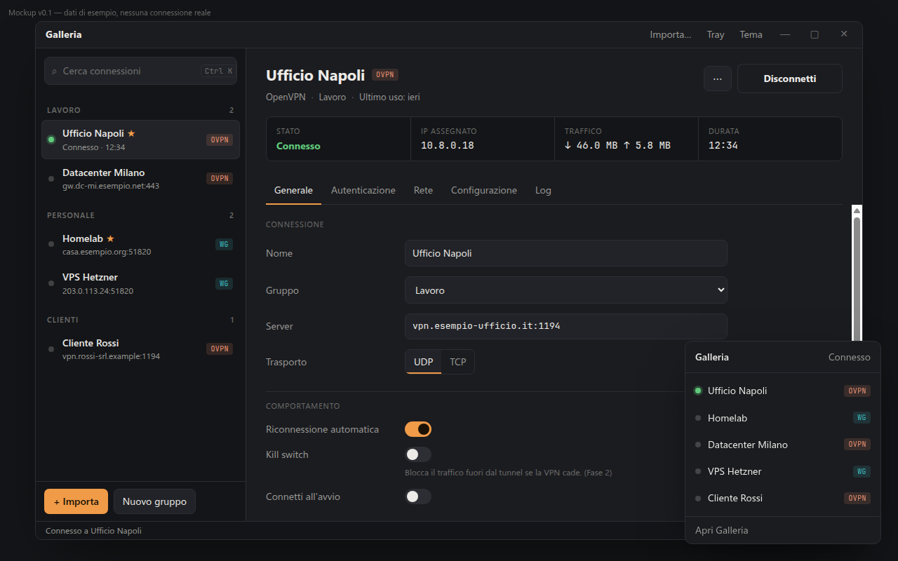

# Galleria

Client desktop open source per OpenVPN e WireGuard (poi le VPN aziendali via OpenConnect e le reti filtrate): una rubrica di connessioni in stile VirtualBox,
una connessione attiva alla volta, Linux e Windows (macOS in seguito).

Stato: demone Linux e CLI minima implementati, con laboratorio Docker per WireGuard e OpenVPN.
La GUI resta un mockup; CI remota, desktop con NetworkManager e DCO restano da verificare.
Vedi [esito della fase 1](docs/06-esito-fase1.md) e [laboratorio](lab/README.md).

Un solo `galleria-gui` alla volta: avviato con un file (`galleria-gui profilo.ovpn`, o il doppio click) mentre la finestra è già aperta,
le consegna il file e termina; il canale è un socket `0600` in `$XDG_RUNTIME_DIR/galleria` (senza quella cartella l'app parte lo stesso, per conto suo).
Solo i `.ovpn` sono associati all'app (`packaging/linux/io.github.zpeppoz.galleria.desktop`, non installato da nessuno script: i pacchetti sono della fase 4).

## Documenti

- [`docs/00-mercato-e-concorrenti.md`](docs/00-mercato-e-concorrenti.md) — concorrenti, buco reale, validazione
- [`docs/01-analisi.md`](docs/01-analisi.md) — decisioni, funzionalità, architettura, fasi, rischi, punti aperti
- [`docs/02-modello-minacce.md`](docs/02-modello-minacce.md) — cosa proteggiamo, da chi, come
- [`docs/03-sessione-nello.md`](docs/03-sessione-nello.md) — scaletta delle decisioni tecniche con il CTO
- [`design/mockup/Rubrica.html`](design/mockup/Rubrica.html) — mockup cliccabile (aprire nel browser; stati demo con `#on`, `#log`, `#import`, `#tray`, `#light`)

## Licenza

GPL-3.0-or-later. Vedi [`LICENSE`](LICENSE).
